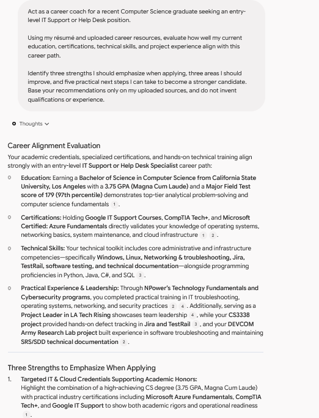
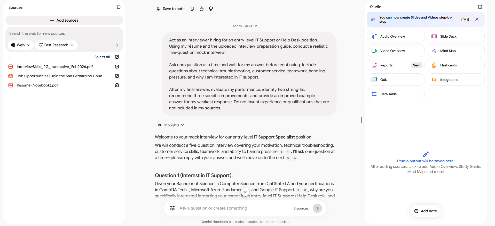
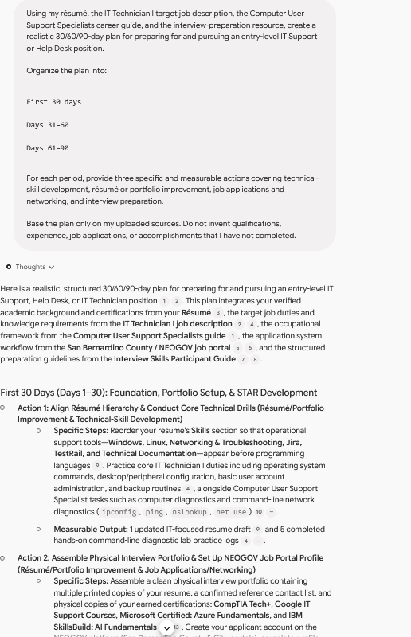
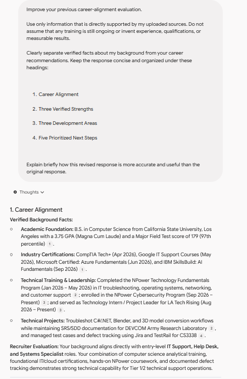

# IT Launch Coach

### AI Pre-Apprenticeship Capstone

An AI Career Coach created with Google NotebookLM to help a recent Computer Science graduate prepare for entry-level IT Support and Help Desk opportunities.

## 1. Project Overview

IT Launch Coach is a source-grounded career assistant focused on early-career IT Support preparation. It uses curated career resources to provide career guidance, conduct a mock interview, and create a practical 30/60/90-day career plan.

**Career pathway:** Entry-level IT Support / Help Desk  
**Built with:** Google NotebookLM

## 2. The Problem and Goal

Recent graduates may have education, certifications, and project experience but still need help translating that background into an organized job-search strategy. Generic AI advice can also introduce assumptions that are not supported by a candidate's real experience.

The goal of IT Launch Coach is to provide structured, source-grounded guidance for:

- Identifying relevant strengths and development areas
- Practicing technical and behavioral interview questions
- Planning measurable career-development and job-search activities
- Checking AI output for unsupported or misleading claims

## 3. Tools and Sources

I built and tested the assistant in **Google NotebookLM** using the following sources:

- A private resume used only inside NotebookLM
- [U.S. Department of Labor - Interview Skills Participant Guide](https://www.dol.gov/sites/dolgov/files/VETS/files/InterviewSkills_PG_Interactive_Feb2026.pdf)
- [City of San Bernardino - IT Technician I (Flex) job description](https://www.governmentjobs.com/careers/citysanbernardino/classspecs/1019200)
- [O*NET - Computer User Support Specialists](https://www.onetonline.org/link/details/15-1232.00)
- [San Bernardino County Job Opportunities portal](https://www.governmentjobs.com/careers/sanbernardino)

These materials provided information about IT support responsibilities, interview preparation, occupational expectations, application workflows, and the candidate's verified background.

## 4. How IT Launch Coach Works

1. Relevant career documents and public resources are added to a private NotebookLM notebook.
2. Selected sources ground each prompt and provide citations for the response.
3. The user reviews the response for accuracy, unsupported assumptions, and privacy concerns.
4. Prompts are revised when the output is too broad or contains claims that are not clearly supported.
5. Approved outputs are summarized in this public repository without publishing the private notebook or source documents.

## 5. IT Launch Coach in Action

### Example 1: Career Guidance

**Prompt:** Evaluate how the candidate's education, certifications, technical skills, and project experience align with an entry-level IT Support or Help Desk career. Identify three strengths, three development areas, and five practical next steps without inventing qualifications.

**What the AI helped me understand:** The response showed how technical education, certifications, troubleshooting practice, documentation, and project leadership could be positioned for IT Support roles. It also suggested prioritizing support-related skills and practicing structured interview responses.



### Example 2: Mock Interview

**Prompt:** Conduct a five-question mock interview for an entry-level IT Support or Help Desk position. Cover motivation, troubleshooting, customer service, teamwork, and handling pressure, then evaluate the answers and recommend improvements.

**What I learned:** The exercise provided practice answering both technical and behavioral questions. The final evaluation identified systematic troubleshooting and empathetic customer support as strengths while recommending more varied examples for behavioral questions.



Additional evidence:

- [Sample interview answer](screenshots/mock-interview-answer.png)
- [Mock-interview evaluation](screenshots/mock-interview-evaluation.png)

### Example 3: 30/60/90-Day Career Plan

**Prompt:** Use the resume, target job description, occupational guide, job portal, and interview resource to create a realistic 30/60/90-day plan with measurable actions for technical skills, resume and portfolio improvement, applications, networking, and interview preparation.

**My planned next steps:** The plan organizes future activities into three stages: strengthening job materials and technical practice, submitting targeted applications and completing mock interviews, and improving interview follow-up and self-evaluation. These actions are goals, not claims of completed applications or interviews.



## 6. Testing and Improving the Assistant

### Original prompt

The original career-guidance prompt asked for strengths, development areas, and next steps based on the uploaded sources.

### Improved prompt

The revised prompt required NotebookLM to:

- Use only information directly supported by uploaded sources
- Avoid assuming that training was still ongoing
- Avoid inventing experience, qualifications, or measurable results
- Separate verified background facts from career recommendations
- Organize the response under consistent headings



### What changed and why

The improved prompt produced a clearer distinction between documented experience and strategic advice. It also made the response easier to evaluate because facts and recommendations were placed in separate sections. The test demonstrated that adding explicit source, structure, and accuracy constraints improves an AI response, although manual review is still necessary.

## 7. Responsible AI

I checked the assistant's output for source accuracy, unsupported assumptions, and privacy risks.

During testing, NotebookLM initially reported that two requested career sources were missing instead of pretending it had used them. I verified the source selection and reran the prompt after confirming access. In another response, I identified recruiter-oriented claims that were interpretations rather than verified facts. I therefore revised the prompt to distinguish source-supported facts from recommendations.

This process showed that source grounding reduces unsupported output but does not replace human review. AI recommendations should be compared with the original sources, and uncertain claims should be removed or rewritten cautiously.

Information that should never be published or entered into an untrusted assistant includes:

- Home address, personal telephone number, or private email address
- Account passwords, API keys, or authentication information
- Private transcripts, identification documents, or confidential records
- Unredacted resumes containing unnecessary personal information
- Confidential employer, school, or client information

## 8. My 30/60/90-Day Career Plan

### First 30 days

- Tailor the resume toward IT Support responsibilities and terminology
- Complete and document hands-on troubleshooting practice
- Configure job alerts and organize a job-search tracking process
- Prepare several truthful STAR stories from documented experience

### Days 31-60

- Continue technical support labs and ticket-documentation practice
- Submit targeted applications and track their status
- Complete mock interviews and improve responses using feedback
- Research employers and prepare thoughtful candidate questions

### Days 61-90

- Participate in interviews if opportunities are scheduled
- Send timely, personalized follow-up messages after interviews
- Complete a self-evaluation after each interview
- Continue refining skills, application materials, and the candidate pipeline

## 9. Reflection

**What was the most useful thing the AI coach did?**  
It converted several career resources into an organized set of strengths, interview exercises, and actionable next steps.

**What limitation or mistake did I discover?**  
The assistant could still produce broad recruiter interpretations or fail to recognize newly added sources. Its citations and claims had to be checked manually before the output could be used.

**How could this assistant help someone in a real job search?**  
It can help a candidate organize job-search activities, practice communicating technical knowledge, prepare for interviews, and identify areas that need more evidence or experience.

**What would I improve in a future version?**  
I would add more current target job descriptions, use a consistent scoring rubric for interview answers, test a wider range of technical scenarios, and build a stronger process for checking every recommendation against its cited source.

## 10. Skills Demonstrated

- Prompt engineering
- AI output evaluation
- Research and source curation
- Responsible AI practices
- GitHub documentation
- Career readiness

## Repository Structure

```text
AI_Pre_Apprenticeship_Notebook_LM/
|-- README.md
`-- screenshots/
    |-- career-guidance-original.png
    |-- career-guidance-improved.png
    |-- career-plan.png
    |-- mock-interview.png
    |-- mock-interview-answer.png
    `-- mock-interview-evaluation.png
```
